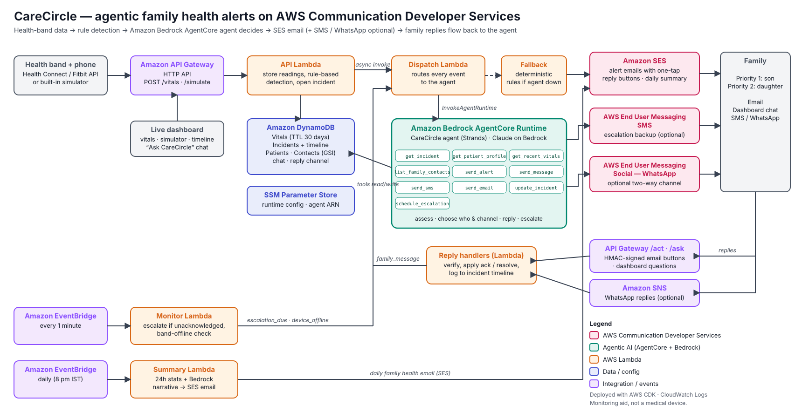

# CareCircle — agentic family health alerts

CareCircle watches an older family member's health-band data and keeps the family in the loop.
When something looks wrong — a racing heart while resting, low blood oxygen, a fall — an
**Amazon Bedrock AgentCore** agent checks the context, decides how serious it is, and alerts the
right family member by **email (Amazon SES)** with one-tap reply buttons: **I'm checking**,
**Show trend**, **All fine now**. Family can also ask questions in the dashboard
(*"How is Appa now?"*) and the agent answers from the real readings. If nobody responds, it
escalates to the next person (plus **SMS** if configured). Every evening the family gets a
**daily summary email**. **WhatsApp** (AWS End User Messaging Social) is built in and switches on
as soon as you add a WhatsApp number.

> CareCircle is a monitoring and notification aid, **not a medical device**. It never diagnoses.



## What makes it agentic (not a rules bot)

| Situation | Rule-based alerting | CareCircle agent |
|---|---|---|
| HR 135 during the morning walk | Alerts everyone | Sees 110 steps/min → no alert |
| HR 130 for 5 min at rest | Same message to everyone | Warning → priority-1 contact, escalation in 5 min |
| Fall detected | Same message to everyone | Critical → all contacts, includes emergency number (108), 2-min escalation |
| Son taps "I'm checking" | Nothing | Stops escalation, tells daughter son is on it |
| "How is Appa now?" (any language) | Nothing | Pulls last hour of vitals, answers with real numbers |
| Nobody answers | Repeats | Re-checks vitals, escalates to the next contact |

The rules (`backend/carecircle/detection.py`) only decide *whether something might be wrong*.
The agent (`backend/agent_app.py` + `backend/agent_tools.py`) decides *what to do*. Every tool
call is written to the incident timeline shown on the dashboard.

**Works before the agent is deployed:** a deterministic fallback (`backend/carecircle/fallback.py`)
handles every event when the agent isn't connected (dashboard shows *Rules mode*). Deploy the
stack first, get the emails working, then connect the agent.

## AWS services

| Service | Role |
|---|---|
| **Amazon SES** | Alert emails with signed one-tap reply buttons, follow-ups, daily summary |
| **AWS End User Messaging SMS** *(optional)* | Escalation backup |
| **AWS End User Messaging Social — WhatsApp** *(optional)* | Two-way WhatsApp alerts and replies |
| **Amazon Bedrock AgentCore Runtime** | Hosts the CareCircle agent (Strands Agents) |
| **Amazon Bedrock** | Claude model for the agent and the daily-summary narrative |
| AWS Lambda (×5), API Gateway HTTP API | Ingest/API, dispatch, replies, monitor/escalation, summary |
| Amazon DynamoDB | Vitals (TTL), incidents + timeline, patients + chat, contacts |
| Amazon EventBridge | 1-minute escalation monitor, daily summary schedule |
| Amazon SNS, SSM Parameter Store | WhatsApp event destination, runtime config |
| AWS CDK | All infrastructure as code |

---

## Quick start — working demo in ~30 minutes

### 0. Prerequisites

- An AWS account with the AWS CLI v2 configured (`aws configure`). Use the region your account
  works in — new Free-plan accounts are locked to one region (e.g. **ap-southeast-2**, Sydney); set
  the same value as `region` in `infra/config.json`
- Python 3.12+, Node.js 18+, and the CDK CLI: `npm install -g aws-cdk`
- Two email inboxes you can open on camera (a Gmail `+` alias works: `you+priya@gmail.com`)
- No Docker needed

### 1. Configure

```bash
cp infra/config.example.json infra/config.json
python3 -c "import secrets; print(secrets.token_urlsafe(24))"     # paste as apiToken
```

Edit `infra/config.json`: set `apiToken` and `sesFromEmail` (your own email address is fine).
Leave `waPhoneNumberId` and `smsOriginationIdentity` empty.

```bash
cp seed/family.example.json seed/family.json
```

Edit `seed/family.json`: put the two inboxes in the two contacts' `email` fields. The `phone`
values are just IDs unless you enable WhatsApp/SMS.

### 2. Deploy the stack

```bash
./scripts/build_layer.sh                 # bundles a recent boto3 for the Lambdas
cd infra
python3 -m venv .venv && source .venv/bin/activate
pip install -r requirements.txt
cdk bootstrap                            # once per account/region
cdk deploy                               # note the DashboardUrl output
cd ..
```

### 3. Add the family + verify emails

```bash
pip install boto3
python3 scripts/seed.py seed/family.json --region ap-southeast-2
```

This loads Appa and the contacts and asks SES to verify every email address (sender and
family). **Open each inbox and click the AWS verification link** (check spam). New SES accounts
are in the *sandbox*, which can only send to verified addresses — that is all a demo needs.

### 4. Try it (rules mode)

Open the `DashboardUrl`, enter your `apiToken`, then:

1. **Morning walk** → no alert (high HR while moving is normal).
2. **Racing heart** → the priority-1 inbox gets an alert email within seconds.
3. Tap **Show trend** in the email → a page shows the last hour of readings.
4. Tap **I'm checking** → the incident turns *ACKNOWLEDGED* and escalation stops.
5. Ask in the dashboard: *How is Appa now?*
6. **Fall** → both inboxes are alerted; with no reply the next contact is escalated after 2 min.
7. **Email today's summary** → daily summary email.

Use **Close** on an incident to reset before the next scenario.

### 5. Connect the AgentCore agent

```bash
pip install bedrock-agentcore-starter-toolkit
cd backend
agentcore configure -e agent_app.py --region ap-southeast-2 --disable-memory   # Enter = auto-create role + ECR
agentcore launch                                                          # prints the Agent ARN
cd ..
./scripts/connect_agent.sh <agent-runtime-arn> ap-southeast-2
```

The dashboard badge changes to **AgentCore agent online**, and the timeline now shows the
agent's assessments and decisions.

**Pick a model that works in your account** (do this before step 5): in the Bedrock console →
*Model catalog* → a Claude model → *Open in playground*, submit the one-time Anthropic use-case
form and send "hello". Then run `python3 scripts/check_model.py` — it tests Claude model IDs in
your region and prints the `modelId` to put in `infra/config.json`. After changing
`infra/config.json`, run `cdk deploy` again (the agent reads its config from Parameter Store).

If the agent fails or times out, the dispatch Lambda automatically falls back to the rules,
so alerts still go out.

---

## Optional channels

**SMS** — AWS End User Messaging SMS → get an origination identity → set
`smsOriginationIdentity` → `cdk deploy`. Contacts' `phone` must then be real E.164 numbers.
(SMS to Indian numbers requires DLT registration.)

**WhatsApp** — AWS End User Messaging Social → *Add WhatsApp phone number* (needs a number that
isn't already on WhatsApp) → set `waPhoneNumberId` → `cdk deploy` → on the WABA's *Event
destination* select the `WhatsAppEventTopicArn` SNS topic. Templates: `docs/whatsapp-templates.md`.
Alerts then go out on WhatsApp **and** email; replies come back through SNS.

## Sending real band data

```bash
curl -X POST <ApiEndpoint>/vitals -H "x-api-token: <apiToken>" -H "content-type: application/json" \
  -d '{"patientId":"appa","readings":[{"ts":1793090000,"hr":82,"spo2":97,"steps":12}]}'
```

Or stream simulated readings in real time:

```bash
python3 scripts/simulate.py --api <ApiEndpoint> --token <apiToken> --live \
  --scenario normal --then resting_tachycardia --switch-after 60
```

## Troubleshooting

| Symptom | Fix |
|---|---|
| Dashboard says *unknown patient* | Run `scripts/seed.py` |
| No alert email | Both addresses verified in SES? Check spam. Timeline shows `email_failed` with the SES error |
| `MessageRejected: Email address is not verified` | Click the verification link (step 3) |
| Badge says *Rules mode* | Agent not connected yet (step 5) — everything else works |
| Agent errors in timeline (`agent_fallback`) | CloudWatch logs of the AgentCore runtime; check Bedrock model access and `modelId` |
| Lambda logs | CloudWatch → `/aws/lambda/CareCircle-*` |

## Repository layout

```
backend/
  agent_app.py            AgentCore Runtime entrypoint (system prompt, Strands agent)
  agent_tools.py          10 tools: vitals, incidents, contacts, alerts, messages, SMS, email, escalation
  carecircle/             shared library (Lambdas + agent)
    detection.py          explainable rules: resting tachycardia, low SpO2, bradycardia, fall
    actions.py            channel routing (email / dashboard / WhatsApp / SMS), timeline logging
    emails.py             alert + reply emails, HMAC-signed one-tap action links
    messaging.py          SES / SMS / WhatsApp API calls
    fallback.py           deterministic safety net
    store.py service.py simulation.py whatsapp_events.py config.py agent_client.py
  handlers/               Lambda handlers + dashboard.html
infra/                    AWS CDK app (Python)
scripts/                  build_layer.sh, seed.py, simulate.py, connect_agent.sh
seed/family.example.json  the person being monitored + family contacts
tests/                    detection, WhatsApp parsing, end-to-end flows
docs/                     architecture diagram, submission text + demo script, WhatsApp templates
```

## Tests

```bash
pip install -r requirements-dev.txt
pytest -q
```

The end-to-end tests run the full flows on mocked DynamoDB with sending in dry-run mode:
email alert → button acknowledge → escalation stops; escalation to the next contact; falls
alert everyone and coordinate; dashboard questions; signed-link tampering is rejected;
WhatsApp mode when enabled.

## Clean up

```bash
cd infra && cdk destroy
cd ../backend && agentcore destroy
```

## License

MIT — see [LICENSE](LICENSE).
